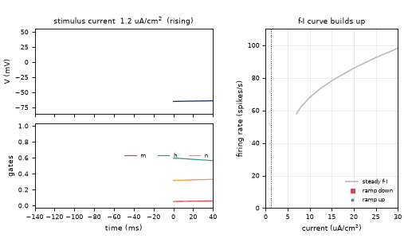
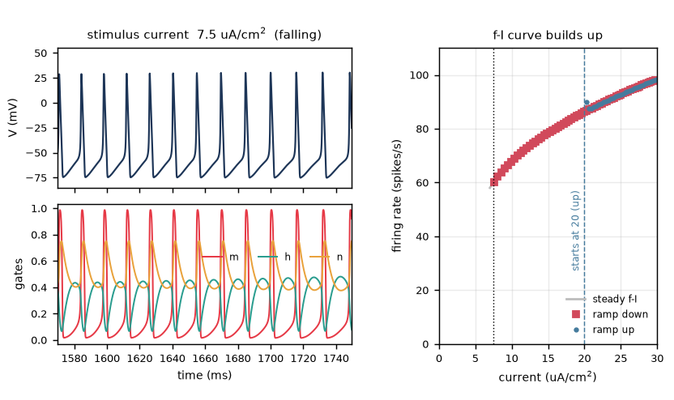
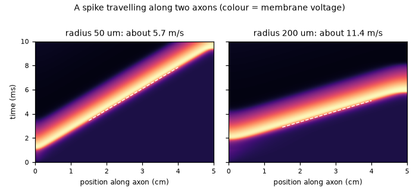
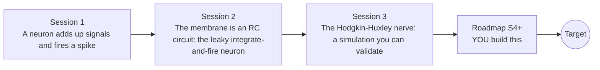

# openneuron

[](https://github.com/KrunalPanchal1995/openneuron/actions/workflows/ci.yml)   [](https://colab.research.google.com/github/KrunalPanchal1995/openneuron/blob/main/sessions/session-01/lesson.ipynb) [](https://krunalpanchal1995.github.io/openneuron/)

**Simulate a nerve cell firing, and how its signal travels, in three sessions.**

openneuron teaches how a neuron adds up signals and fires a spike, from a threshold toy model, through the leaky integrate-and-fire circuit, to the Hodgkin-Huxley equations integrated with your own RK4.

- **Start from zero.** Session 1 needs only school arithmetic and the idea of a voltage; every symbol is explained.
- **See it fire.** Every session ships a slider app that runs in the browser, with labelled voltage traces and graphs.
- **Know you got it right.** Each session ends with a checkpoint that prints PASS or FAIL against hand calculations and reference cases.
- **Build the missing half.** The repo stops at Session 3 on purpose; the roadmap shows the path to the Target.

[Target](#the-target) · [Who is this for](#who-is-this-for) · [Quick start](#quick-start) · [Sessions](#sessions) · [Roadmap](#roadmap) · [Contribute](#contribute) · [Explainer PDF](docs/explainer.pdf)

> **This repo is incomplete on purpose.** Sessions 1 to 3 are here and fully working. The finished Target below is a preview of what the community can build next. We show you the path, not the code. Sessions 4 and up are yours.

## The Target

A model nerve cell receives a stimulus current that ramps slowly up and then back down. The animation shows its membrane voltage, the three gating variables of the Hodgkin-Huxley model and an f-I curve (firing rate against current) that builds up point by point. On the way up the cell stays silent well beyond the steady onset current you measure in Session 3 (it accommodates the slow ramp), then fires repetitively and speeds up; on the way down it keeps firing below the current where it started, so the up and down branches of the f-I curve do not coincide. Your goal over the coming sessions: build that animation yourself, with a stimulus ramp, a stable integrator and a live firing-rate estimate.



*Target: membrane voltage, gating variables and a building f-I curve while the stimulus ramps up*



*Target, one frame: repetitive firing and the f-I curve so far*



*Target extra: a spike travelling along two axons of different diameter (space-time picture)*

Try it live:

- [Math Visual Studio: ordinary differential equations (Atlas S16)](https://krunalpanchal1995.github.io/studio/#atlas?ch=S16&ex=1)

How the Target was made is shown only as a path in [promo/roadmap.md](promo/roadmap.md).

## Who is this for
**secondary school to diploma / undergraduate (levels 3-5).** Topic area: Biology, Human Body and Health Science.

Prerequisites:

- School algebra, the idea of a voltage and a current, and the exponential function (Session 2 recalls it).
- Python 3.10 or newer; if `python --version` works, you are ready. PRIMER.md explains the rest.
- No prior GitHub, biology or differential-equation experience is needed. This repo is general education, not medical advice.

New to Python? Read [PRIMER.md](PRIMER.md) first (10 minutes).

## Quick start

No installation knowledge needed. You need [Git](https://git-scm.com/downloads) and [Python 3.10+](https://www.python.org/downloads/) (Windows: tick "Add Python to PATH"). On Mac and Linux type `python3` wherever this page says `python`.

```bash
git clone https://github.com/KrunalPanchal1995/openneuron.git
cd openneuron
python start.py 1
```

`start.py` creates a private environment, installs what is needed and runs Session 1 with its checkpoint. Next: `python start.py 2`, `python start.py 3`, or `python start.py test` to check everything. Only a checkpoint: `python start.py check 1`.

A few lines turn the idea of Session 2 into a result (they work as they are): Save it as `try.py` and run it with `python start.py run try.py` (this uses the private environment, where NumPy is installed):

```python
import numpy as np
tau, R, I = 10.0, 100.0, 0.2        # ms, megaohm, nanoamp (typical values)
rise = R * I                        # the voltage would settle R I = 20 mV above rest
T = tau * np.log(rise / (rise - 15))  # time to climb the 15 mV to threshold
print(round(T, 3), 'ms ->', round(1000 / (T + 2), 2), 'spikes per second')   # -> 13.863 ms -> 63.04
```

Every session also opens in your browser with sliders (no install): [live apps](https://krunalpanchal1995.github.io/openneuron/). Or use the Colab badge above for the notebook.

## Sessions

| # | Session | Model level | Time | Live app |
|---|---|---|---|---|
| 1 | [A neuron adds up signals and fires a spike](sessions/session-01/README.md) | Level 1: conceptual interactive model | 60 min | [open](https://krunalpanchal1995.github.io/openneuron/session-01/) |
| 2 | [The membrane is an RC circuit: the leaky integrate-and-fire neuron](sessions/session-02/README.md) | Level 2: mathematical engineering model | 75 min | [open](https://krunalpanchal1995.github.io/openneuron/session-02/) |
| 3 | [The Hodgkin-Huxley nerve: a simulation you can validate](sessions/session-03/README.md) | Level 3: simulation and validation | 90 min | [open](https://krunalpanchal1995.github.io/openneuron/session-03/) |

Each session follows the same six steps: A real-world problem, B concept and theory, C visual explanation, D interactive simulation, E worked example and experiment, F assessment and design challenge. Each ends with `checkpoint.py`, which prints `PASS` or `FAIL` against reference numbers. Session 3 also contains the real-world mini-project: **Find the weakest stimulus and the fastest firing of a model nerve**.

## Architecture



| Folder or file | What is inside |
|---|---|
| `sessions/` | three sessions: README (A-F), `lesson.py`, notebook, live app, exercises, activity sheet, checkpoint |
| `promo/` | the Target: media, live links, and the roadmap (path only) |
| `docs/` | `explainer.tex` and the built `explainer.pdf` |
| `tests/` | runs every lesson and checkpoint headless |
| `start.py` | one command to set up and run anything |
| `QUALITY.md`, `RUBRIC.md` | the quality checklist and the scoring rubric |
| `.github/` | CI, PDF build, Pages deploy, issue and PR templates |

## Roadmap

| Milestone | What you will build | Difficulty |
|---|---|---|
| Session 4: Up-and-down current sweep and a live f-I curve | A simulation with a triangle current ramp (zero to 30 and back to zero uA/cm^2 over 2000 ms) whose f-I curve is built point by point, separately for the up and the down branch. | intermediate |
| Session 5: A stable integrator for large steps | A solver that integrates the gating equations with the exact exponential update and V with a stable scheme. | advanced |
| Session 6: Saltatory conduction in a myelinated axon | A cable model with insulated segments and active nodes. | advanced |
| Session 7: Two neurons joined by a synapse | Two leaky integrate-and-fire neurons, the first driving the second. | intermediate |
| Session 8: Spike-frequency adaptation | A leaky integrate-and-fire neuron with an adaptation variable. | intermediate |

Full detail with a checkpoint per milestone: [promo/roadmap.md](promo/roadmap.md).

## Contribute
New to GitHub? Read [CONTRIBUTING.md](CONTRIBUTING.md); it starts from zero. Pick an issue labelled `good first issue`. Translations into Hindi, Telugu, Tamil and Malayalam are welcome.

<details>
<summary>Development</summary>

```bash
python start.py test        # runs every lesson and checkpoint
```
Lessons use `# %%` cell markers so they open as notebooks in VS Code. See [QUALITY.md](QUALITY.md) for the standard every session meets.
</details>

## License
MIT. See [LICENSE](LICENSE). Media in `promo/media` is (c) Krunal Panchal, CC BY 4.0.

## Acknowledgments
Part of the [PAN IIT OSS](https://hellofoss.tech-iitb.org/projects) open-source teaching collection, modelled on the structure of [openspline](https://github.com/openspline/openspline). Built on ideas from the Math Visual Studio at https://krunalpanchal1995.github.io/studio/.
