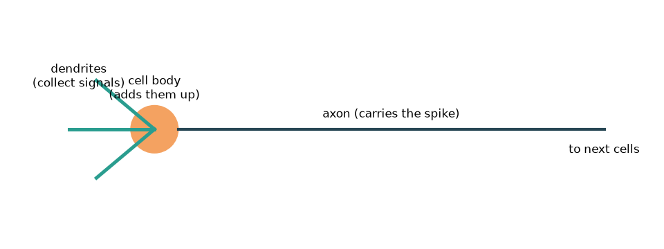
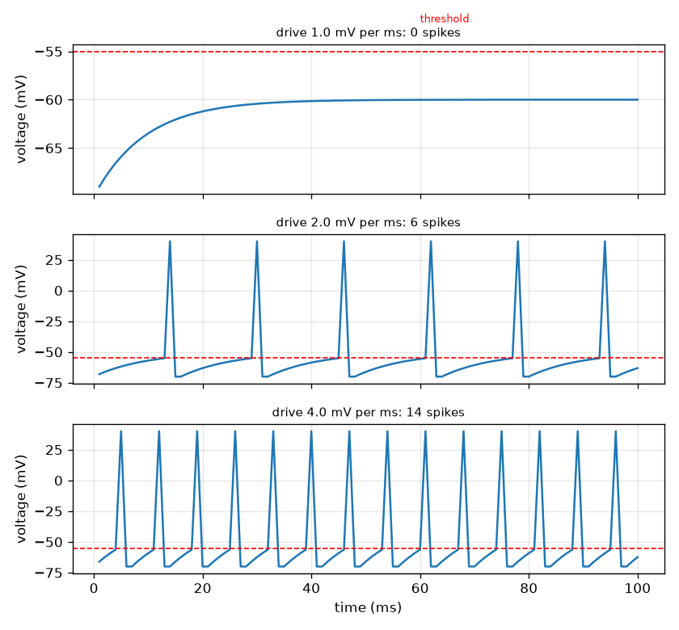

# Session 1: A neuron adds up signals and fires a spike

*Level 1 (conceptual interactive model) · about 60 minutes · openneuron*

> This is a simplified educational model. It is not a validated design tool and must not be used for real structures, electrical installations, vehicles, industrial processes or medical decisions.

**Prerequisites**

- School arithmetic and the idea of a voltage (a push on electric charge).
- You have read PRIMER.md and run `python start.py 1` once.

**Learning objectives.** After this session you can:

- Describe how a neuron collects signals, sums them and fires an all-or-nothing spike at a threshold.
- Use the rise-and-leak update to predict whether a constant input can ever fire the neuron.
- Read a voltage-versus-time trace and tell a spike from a sub-threshold wobble.
- Compute the delay of a spike along an axon from its length and speed.

## A. Real-world problem
Every thought, touch and movement is carried by nerve cells that talk with brief electrical pulses called spikes. A neuron receives signals from other cells on its branches (dendrites), adds them up in its cell body, and, if the total voltage crosses a threshold, fires one spike that runs down its long wire (the axon). A faint touch makes few spikes and a hard push makes many, but every spike looks the same. How can a cell turn a smooth input into this on-off signal? This repo is general education only: it shows a simplified model, not medical information.

## B. Concept and theory
We model the voltage V inside the cell relative to the outside, in millivolts (mV). At rest it sits at V_rest = -70 mV (a typical textbook value). Each millisecond the input pushes V up by the drive d (mV per ms) and a leak pulls it back towards rest by a fraction k = 0.1 of the distance. If the drive is constant, V settles at V_rest + d / k. A threshold V_th = -55 mV decides firing: when V reaches it, the neuron fires a spike of fixed height, V resets to rest, and a refractory time of 2 ms follows during which it cannot fire again. A constant drive can fire the neuron only if the settling level lies above the threshold, which means d > k (V_th - V_rest) = 1.5 mV per ms. After the spike starts, it travels along the axon at a roughly constant speed v, so the delay over a length L is L / v.

| Symbol | Meaning | Unit |
|---|---|---|
| V | membrane voltage (inside minus outside) | mV |
| V_rest | resting voltage, typical -70 | mV |
| V_th | threshold voltage, typical -55 | mV |
| d | drive: push added to V each millisecond | mV per ms |
| k | leak fraction per millisecond (0.1) | per ms |
| L, v | axon length and spike speed | m, m per s |

**Assumptions**

- Time moves in steps of 1 ms.
- The input is a constant drive or a list of pushes, one per step.
- Every spike has the same drawn height (+40 mV) whatever the input: all or nothing.
- All numbers are typical textbook values; this is a simplified educational model, not a medical tool.

$$ V_{n+1}=V_n+d-k\,(V_n-V_{\mathrm{rest}}) $$

$$ V_\infty=V_{\mathrm{rest}}+\frac{d}{k},\qquad d_{\min}=k\,(V_{\mathrm{th}}-V_{\mathrm{rest}}) $$

$$ \Delta t=\frac{L}{v} $$

## C. Visual explanation
The first figure is a picture of a neuron: dendrites collect signals, the cell body adds them up, and the axon carries the spike to the next cells. The second figure shows three voltage traces for weak, medium and strong drive. With the weak drive the voltage creeps up and levels off below the red threshold line: no spike. With the medium and strong drive the voltage reaches the threshold again and again; each spike has the same height, but the stronger drive fires more often (6 spikes against 14 in 100 ms for drives 2.0 and 4.0).

*A neuron: dendrites collect signals, the cell body adds them up, the axon carries the spike.*

*Voltage traces for weak, medium and strong drive: same spike height, different rate.*

## D. Interactive simulation
Run the lesson (`python start.py 1`), then open the live app: [Session 1: a neuron fires](https://krunalpanchal1995.github.io/openneuron/session-01/) (or `app.html` in this folder). Slide the drive and watch the settling bar cross the threshold mark and the voltage trace start to spike; then slide the axon speed and watch the red dot and the delay change.

**Challenge.** Make the neuron fire (drive above 1.5 mV per ms) and let the spike cross the 0.5 m axon in under 5 ms.

## E. Worked example and experiment
**Problem.** A constant drive of 2.0 mV per ms is applied from rest. Will the neuron fire, and after how many milliseconds?

1. Settling level: V_inf = -70 + 2.0 / 0.1 = -50 mV. That is above the threshold of -55 mV, so it will fire.
2. With the drive constant the climb is V(n) = -70 + 20 (1 - 0.9^n). We need V(n) = -55, which means 20 (1 - 0.9^n) = 15 and so 0.9^n = 0.25.
3. n = ln 0.25 / ln 0.9 = 13.16 steps, so 13 steps are not enough and 14 are.
4. Check: V(13) = -55.08 mV (just below the threshold) and V(14) = -54.58 mV (above it), so the first spike comes at step 14, that is 14 ms.
5. The simulation agrees: the first spike is at 14 ms and there are 6 spikes in 100 ms.

**Answer.** Yes. The first spike comes at 14 ms (13.16 steps rounded up), and the neuron fires 6 times in 100 ms.

**Experiment.** A real neuron can be recorded with a thin glass electrode while a small steady current is injected: below a certain current the voltage just drifts to a new level, above it spikes appear, and a larger current gives a faster train of identical spikes. The model reproduces that qualitative picture. It differs from the real cell in that real spikes have a shape set by ion channels (Session 3), real thresholds shift with recent activity, and real inputs are noisy rather than a constant push.

## F. Assessment and design challenge
**Question type A: Conceptual.** A stronger stimulus does not make a bigger spike. So how does a nerve tell the brain that a touch is stronger?

Hint

Compare the traces for weak, medium and strong drive: what changed, and what stayed the same?

Step-by-step solution

The spike height is fixed (all or nothing), but a stronger input pushes the voltage back to the threshold sooner after each spike, so the neuron fires more often. The strength is carried by the rate (and by how many neurons fire), not by the size of a spike. In the model the drive 2.0 gives 6 spikes in 100 ms and the drive 4.0 gives 14, all of the same height.

**Question type B: Numerical.** For a constant drive of 3.0 mV per ms find the level the voltage would settle at, and the step at which the first spike happens (hand calculation, then check with the code).

Hint

Settling level = -70 + d / 0.1. The first spike needs 0.9^n = 1 - 15 (0.1) / d.

Step-by-step solution

Settling level = -70 + 3.0 / 0.1 = -40 mV, above the threshold. Then 0.9^n = 1 - 1.5 / 3.0 = 0.5, so n = ln 0.5 / ln 0.9 = 6.58, rounded up to step 7. The code gives the first spike at 7 ms. Unit check: the drive is in mV per ms, so d / k is in mV.

**Question type C: Graph and simulation interpretation.** In the trace for drive 1.0 mV per ms the voltage rises and then flattens out below the threshold line. What level does it flatten at, and why is there no spike?

Hint

Use the settling level -70 + d / 0.1 and compare it with -55.

Step-by-step solution

It flattens at -70 + 1.0 / 0.1 = -60 mV, 5 mV below the threshold of -55 mV. The leak removes charge as fast as the drive adds it once V reaches -60, so the voltage never gets to -55 and there is no spike. Raising the drive to above 1.5 mV per ms moves the settling level above the threshold.

**Question type D: Design and optimisation challenge.** Design: a model neuron must fire at least 10 times in 100 ms, and a spike must cross a 0.5 m axon in under 5 ms. Choose a drive (in steps of 0.5 mV per ms) and an axon speed, and say what trade-off you see.

Hint

Count the spikes for drive 2.5, 3.0 and 3.5 with the code; the delay is 1000 L / v in ms.

Step-by-step solution

Drive 2.5 gives 9 spikes (too few), drive 3.0 gives 11 spikes and drive 3.5 gives 12, so the smallest drive in steps of 0.5 that works is 3.0 mV per ms. The delay is 1000 (0.5) / v < 5 ms, so v must exceed 100 m/s (exactly 5 ms at 100 m/s). Trade-off: a larger drive costs more input but fires faster; a faster axon needs a thicker (or insulated) fibre, which takes more space and material. Assumption: constant drive and constant speed.

Score yourself with [RUBRIC.md](../../RUBRIC.md). Print the [activity sheet](activity_sheet.md) to work on paper.

## Common misconceptions
| Common misconception | What is actually true |
|---|---|
| A strong stimulus makes a bigger spike. | Spikes are all or nothing: the height is fixed. A stronger stimulus makes spikes more often. |
| Any input, however weak, eventually fires the neuron if you wait. | The leak removes charge as fast as a weak input adds it, so the voltage settles below the threshold and never fires. |
| A spike is a current flowing along the axon like electricity in a copper wire. | A spike is a travelling change of the membrane voltage that is regenerated along the way; it is much slower than electricity in a wire (metres per second, not thousands of kilometres per second). |
| The neuron can fire as often as the input allows. | After each spike there is a refractory time, so the rate has an upper limit (in this toy model one spike per 3 ms). |

## Glossary
- **neuron**: a nerve cell that receives, adds up and passes on electrical signals
- **spike (action potential)**: a brief, fixed-size pulse of membrane voltage that a neuron fires
- **threshold**: the voltage at which the neuron fires
- **axon**: the long wire of a neuron that carries the spike away from the cell body
- **refractory period**: the short time after a spike during which the neuron cannot fire again
- **millivolt (mV)**: a thousandth of a volt, the natural unit for membrane voltages

## Finish
1. Do the three coding tasks in [exercises.md](exercises.md).
2. Run `python start.py 1` again after your changes. It ends with the checkpoint; when it prints `PASS`, you are done. (Checkpoint only: `python start.py check 1`.)

Next: [Session 2](../session-02/README.md)
