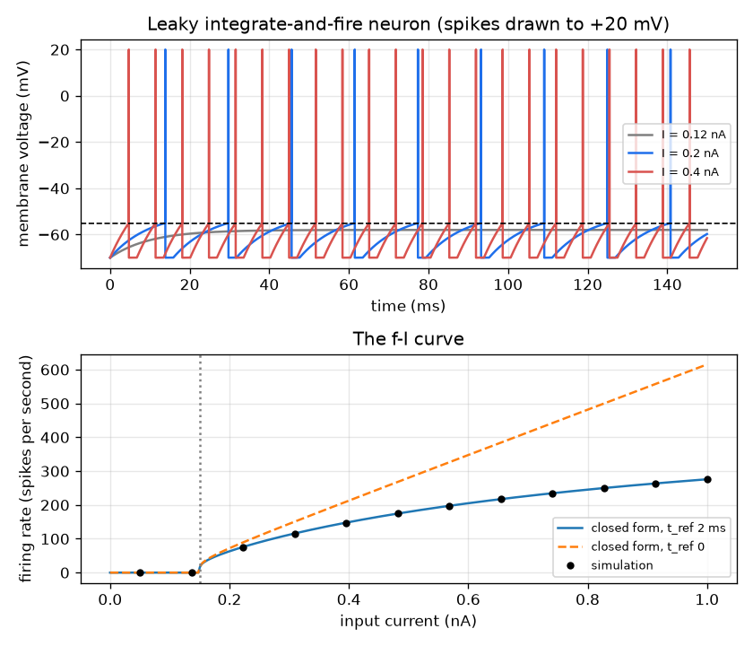
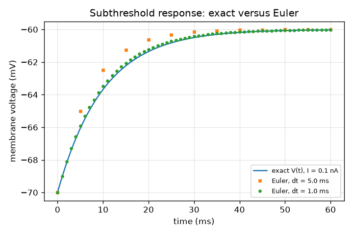

# Session 2: The membrane is an RC circuit: the leaky integrate-and-fire neuron

*Level 2 (mathematical engineering model) · about 75 minutes · openneuron*

> This is a simplified educational model. It is not a validated design tool and must not be used for real structures, electrical installations, vehicles, industrial processes or medical decisions.

**Prerequisites**

- Session 1: threshold, spike, refractory period.
- The exponential function exp(x) and the natural logarithm ln(x); a reminder is given in Section B.

**Learning objectives.** After this session you can:

- Write the membrane equation C dV/dt = -(V - V_rest)/R + I and explain each term.
- Compute the time constant tau = R C and the rheobase current from typical values.
- Derive the closed-form firing rate and check it against a numerical simulation.
- Solve the design problem: which current gives 20 spikes per second?

## A. Real-world problem
The membrane of a nerve cell keeps charge apart, so it stores energy like a capacitor C, and ion channels let charge leak through like a resistor R. If we inject a current I the voltage obeys C dV/dt = -(V - V_rest)/R + I. Add the rule 'when V reaches the threshold, record a spike, reset V and wait a refractory time' and you have the leaky integrate-and-fire (LIF) neuron. How fast does it fire for a given current? And what current makes it fire exactly 20 times a second? (General education only; the numbers are typical textbook values, not measurements of a particular cell.)

## B. Concept and theory
Charge conservation gives C dV/dt = -(V - V_rest)/R + I: the current that does not leak away charges the capacitor. For a constant I the exact solution is V(t) = V_rest + R I (1 - exp(-t / tau)) with tau = R C: the voltage climbs towards V_rest + R I and covers 63.2 percent of the climb in one tau. Units: 1 megaohm times 1 nanoamp is 1 mV, and 1 megaohm times 1 pF is 1 microsecond, so with R in megaohm and C in pF, tau in ms is R C / 1000. Typical values R = 100 megaohm and C = 100 pF give tau = 10 ms. The voltage can reach the threshold V_th = -55 mV only if R I > V_th - V_rest = 15 mV, so the rheobase is I = 15 mV / R = 0.15 nA. Setting V(T) = V_th and solving gives the climb time T = tau ln(R I / (R I - 15 mV)). With the reset at V_rest = -70 mV and a refractory time t_ref = 2 ms, one cycle lasts t_ref + T and the rate is f = 1 / (t_ref + T); with t_ref = 0 it is the closed form f = 1 / (tau ln(R I / (R I - (V_th - V_rest)))). Typical numbers used here: V_rest = -70 mV, V_th = -55 mV, V_reset = -70 mV.

| Symbol | Meaning | Unit |
|---|---|---|
| V | membrane voltage | mV |
| C | membrane capacitance, typical 100 | pF |
| R | membrane (leak) resistance, typical 100 | megaohm |
| I | injected current | nA |
| tau | time constant R C, typical 10 | ms |
| V_rest, V_th, V_reset | rest, threshold and reset voltages, typical -70, -55, -70 | mV |
| t_ref | refractory period, typical 2 | ms |
| f | firing rate | spikes per second (Hz) |

**Assumptions**

- The membrane is one leaky capacitor (a single compartment) with constant R and C.
- The spike is not modelled: when V reaches the threshold we record it, reset V and hold it for t_ref.
- The current is constant during each test, and the reset value equals the rest value.
- All values labelled typical are textbook round numbers; this is a simplified educational model, not a medical tool.

$$ C\,\frac{dV}{dt}=-\frac{V-V_{\mathrm{rest}}}{R}+I $$

$$ V(t)=V_{\mathrm{rest}}+R I\left(1-e^{-t/\tau}\right),\qquad \tau=RC $$

$$ I_{\mathrm{rheo}}=\frac{V_{\mathrm{th}}-V_{\mathrm{rest}}}{R} $$

$$ T=\tau\ln\frac{R I}{R I-(V_{\mathrm{th}}-V_{\mathrm{rest}})},\qquad f=\frac{1}{t_{\mathrm{ref}}+T} $$

## C. Visual explanation
The first figure shows a LIF voltage trace for three currents (spikes drawn up to +20 mV): the grey curve climbs but levels off below the threshold, the blue and red ones fire regularly and the stronger current fires faster. The bottom graph is the f-I curve: the rate is zero up to the rheobase (0.15 nA), then jumps to 33.64 Hz at 0.16 nA, and bends over towards 500 Hz, which is the limit 1 / t_ref. The black dots are the numerical simulation and sit on the closed-form curve. A second figure compares Euler steps with the exact solution.

*Top: LIF voltage traces for three currents. Bottom: the f-I curve, closed form against simulation.*

*Subthreshold climb: the exact solution against Euler steps of 5 ms and 1 ms.*

## D. Interactive simulation
Run the lesson (`python start.py 2`), then open the live app: [Session 2: the leaky integrate-and-fire neuron](https://krunalpanchal1995.github.io/openneuron/session-02/) (or `app.html` in this folder). Change I, R and C. Watch the circuit labels, the voltage trace and the f-I curve with its moving dot. See that tau = R C sets how fast the voltage climbs and that nothing fires below the rheobase.

**Challenge.** Make the neuron fire at 20 spikes per second (within 2) by choosing I, R and C.

## E. Worked example and experiment
**Problem.** For R = 100 megaohm, C = 100 pF and I = 0.2 nA, find the time to reach the threshold and the firing rate with t_ref = 2 ms.

1. tau = R C = 100 x 100 / 1000 = 10 ms. R I = 100 x 0.2 = 20 mV, which is above the 15 mV needed, so it fires.
2. T = tau ln(R I / (R I - 15)) = 10 ln(20 / 5) = 10 ln 4 = 13.863 ms.
3. One cycle = 2 + 13.863 = 15.863 ms, so f = 1000 / 15.863 = 63.04 spikes per second.
4. Without a refractory period the rate would be 1000 / 13.863 = 72.13 per second.
5. Simulation check: the numerical spike train has its first spike at 13.87 ms and every interval is 15.87 ms.

**Answer.** T = 13.863 ms and f = 63.04 spikes per second (72.13 without the refractory period).

**Experiment.** Build a model membrane on a breadboard: a 10 kilohm resistor and a 1 microfarad capacitor in parallel have tau = 10 ms, the same time constant as above. Feed a small constant current and watch the voltage climb with an oscilloscope or a logging multimeter: after one tau it has covered about 63 percent of its final rise. The LIF model differs from a real neuron because the real membrane has many voltage-dependent channels (Session 3), so its resistance changes with voltage, real spikes take about a millisecond, and the real f-I curve is not exactly this logarithmic form.

## F. Assessment and design challenge
**Question type A: Conceptual.** If R stays the same but the capacitance C is halved, does the neuron fire faster or slower for the same current? Explain without equations, then check with a number.

Hint

A smaller capacitor holds less charge for the same voltage, so it fills up (and reaches the threshold) sooner. tau = R C.

Step-by-step solution

Faster. The time constant tau = R C halves, so the voltage reaches the threshold sooner after every reset. Check with R I = 30 mV: for C = 100 pF the rate is 111.96 Hz, for C = 50 pF it is 182.96 Hz and for C = 200 pF it is 63.04 Hz. The threshold level (set by R I) does not change; only the speed of the climb does.

**Question type B: Numerical.** For R = 100 megaohm, C = 100 pF and I = 0.3 nA find the climb time T and the rate f (t_ref = 2 ms).

Hint

R I = 30 mV. Use T = tau ln(R I / (R I - 15)).

Step-by-step solution

tau = 10 ms and R I = 30 mV. T = 10 ln(30 / 15) = 10 ln 2 = 6.931 ms. One cycle = 2 + 6.931 = 8.931 ms, so f = 1000 / 8.931 = 111.96 spikes per second. Sanity check: the current is twice the rheobase, and the rate is well above the 63 Hz found for 0.2 nA, as it should be.

**Question type C: Graph and simulation interpretation.** Describe the shape of the f-I curve: what happens below 0.15 nA, just above it, and for very large currents? What does the limit mean?

Hint

Read the curve at 0.15, 0.16 and the far right of the graph.

Step-by-step solution

Below the rheobase of 0.15 nA the rate is zero. Just above it the rate jumps to a finite value (33.64 Hz at 0.16 nA), because the climb to the threshold becomes quick once R I exceeds 15 mV by even a little. For very large currents the climb time T goes to zero and the rate approaches 1 / t_ref = 500 Hz (for a huge current of 1000 nA it is already 500 Hz to within 0.5). The refractory period sets the maximum rate.

**Question type D: Design and optimisation challenge.** Design: the cell must fire at 20 spikes per second, within 18 to 22. Find the current for exactly 20 per second, the allowed range of current, and say what makes this design delicate.

Hint

Invert the formula: T = 1000 / f - t_ref and R I = 15 / (1 - exp(-T / tau)).

Step-by-step solution

For 20 per second the cycle is 50 ms, so T = 48 ms and R I = 15 / (1 - exp(-4.8)) = 15.12 mV, hence I = 0.1512 nA. For 18 per second I = 0.1507 nA and for 22 per second I = 0.1520 nA, so the allowed range is only about 0.0013 nA wide. The design is delicate because the target rate is close to the rheobase 0.15 nA, where the rate rises steeply with current: raising the current from 0.151 to 0.152 nA (less than 1 percent) raises the rate from 19.17 to 22.07 Hz. Real neurons are noisy, so a more robust design uses a current well above the rheobase and a higher rate.

Score yourself with [RUBRIC.md](../../RUBRIC.md). Print the [activity sheet](activity_sheet.md) to work on paper.

## Common misconceptions
| Common misconception | What is actually true |
|---|---|
| The time constant tau is the time to reach the threshold. | tau = R C is the time to cover 63.2 percent of the climb to the settling level. The time to reach the threshold also depends on R I: T = tau ln(R I / (R I - 15 mV)). |
| The firing rate is proportional to the current. | Below the rheobase it is zero, just above it jumps, and it bends over towards 1 / t_ref. The f-I curve is not a straight line. |
| A bigger R makes the neuron fire more slowly. | A bigger R gives a larger voltage R I for the same current and also a larger tau; the net effect is that a bigger R needs less current to fire (the rheobase is 15 mV / R). |
| A smaller Euler step is not worth the trouble. | The Euler error is proportional to the step: dividing the step by 10 divides the error by about 10. The exact step used in the lesson has no step error for a constant current. |

## Glossary
- **capacitance**: how much charge a membrane stores per volt of voltage
- **resistance**: how strongly the membrane opposes the leak current
- **time constant tau**: R C, the time to cover 63.2 percent of a climb
- **rheobase**: the smallest constant current that can ever reach the threshold
- **f-I curve**: firing rate plotted against input current
- **Euler method**: the simplest step-by-step solver: new value = old value + step x slope

## Finish
1. Do the three coding tasks in [exercises.md](exercises.md).
2. Run `python start.py 2` again after your changes. It ends with the checkpoint; when it prints `PASS`, you are done. (Checkpoint only: `python start.py check 2`.)

Next: [Session 3](../session-03/README.md)
