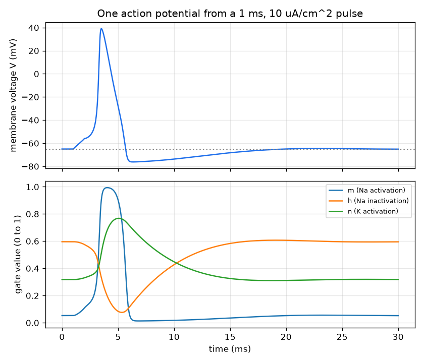
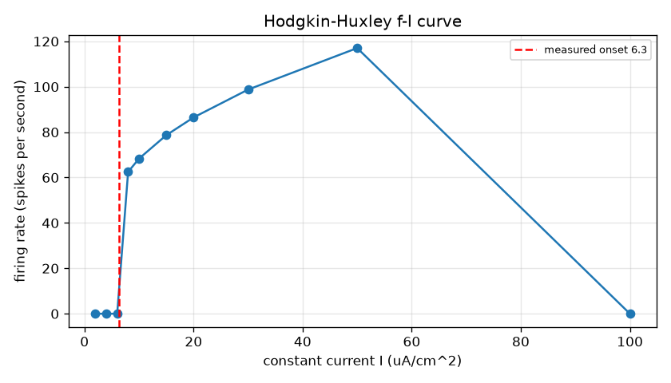
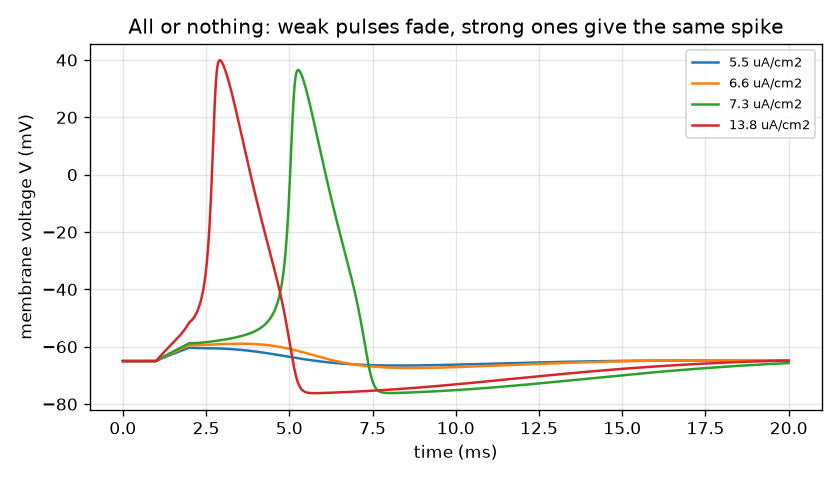

# Session 3: The Hodgkin-Huxley nerve: a simulation you can validate

*Level 3 (simulation and validation) · about 90 minutes · openneuron*

> This is a simplified educational model. It is not a validated design tool and must not be used for real structures, electrical installations, vehicles, industrial processes or medical decisions.

**Prerequisites**

- Session 1: threshold and spikes.
- Session 2: the membrane as an RC circuit and the time constant.
- Basic ideas of a differential equation and a numerical step (Euler); RK4 is explained in the lesson.

**Learning objectives.** After this session you can:

- State the four Hodgkin-Huxley equations with the classic squid-axon parameters and their sign convention.
- Integrate them with your own RK4 and reproduce the action potential, the threshold and the refractory period.
- Measure the onset of repetitive firing and the maximum firing rate, and validate the model against the resting state, a charge balance and the leaky closed form.
- Explain how temperature, sodium conductance and axon diameter change the signal, and why too large a time step blows up the simulation.

## A. Real-world problem
The leaky integrate-and-fire neuron of Session 2 draws the spike by hand. A real nerve cell builds its spike from the physics of ion channels: sodium channels open and let positive charge rush in, then they close and potassium channels open and let charge flow out. In 1952 Hodgkin and Huxley wrote four coupled equations for the squid giant axon that reproduce the spike, the threshold, the refractory period and repetitive firing. Can you integrate them yourself, trust the result, and find out how fast the cell can fire and what makes the signal faster? (General education only: a classic textbook model of one axon, not a medical tool.)

## B. Concept and theory
We use the modern sign convention: V is inside minus outside, rest is near -65 mV, and a depolarisation is a rise of V. The membrane obeys a current balance per unit area with three ion currents: sodium g_Na m^3 h (V - E_Na), potassium g_K n^4 (V - E_K) and a leak g_L (V - E_L). The gates m, h and n are probabilities between 0 and 1 that relax towards values set by the voltage: dx/dt = alpha_x(V) (1 - x) - beta_x(V) x for x = m, h, n, where alpha and beta are the standard empirical rate functions of Hodgkin and Huxley (listed in the lesson, in 1/ms). Classic squid-axon parameters at 6.3 C: C = 1 uF/cm^2, g_Na = 120, g_K = 36, g_L = 0.3 mS/cm^2, E_Na = 50, E_K = -77, E_L = -54.387 mV (the leak reversal is chosen so that rest is -65 mV; in the original 1952 convention V is measured from rest with the opposite sign, E_L = 10.6 mV). Temperature enters through the Q10 idea: all gate rates are multiplied by Q10^((T - 6.3)/10) with Q10 = 3. Axon diameter enters through cable theory: the length constant is lambda = sqrt(r_m / r_i), r_i is proportional to 1/a^2 and r_m to 1/a for radius a, so lambda grows as sqrt(a) and the speed scales as sqrt(a) (a scaling argument, tested below with a cable simulation). Numerics: RK4 takes four slope estimates per step; it is stable only for steps small compared with the fastest time scale of the model.

| Symbol | Meaning | Unit |
|---|---|---|
| V | membrane voltage (inside minus outside) | mV |
| m, h, n | sodium activation, sodium inactivation, potassium activation gates | 0 to 1 |
| C | membrane capacitance per area, 1 | uF/cm^2 |
| g_Na, g_K, g_L | maximum sodium and potassium conductances and the leak, 120, 36, 0.3 | mS/cm^2 |
| E_Na, E_K, E_L | reversal potentials 50, -77, -54.387 | mV |
| I_ext | applied current per area | uA/cm^2 |
| alpha, beta | gate opening and closing rates | 1/ms |
| Q10, T | rate multiplier per 10 C (3) and temperature | no unit, C |
| a, v | axon radius and conduction speed | um, m/s |

**Assumptions**

- A single patch of membrane (space-clamped), then a uniform cable for the speed test.
- Squid giant axon parameters at 6.3 C; a mammalian neuron has other channels and values.
- Temperature scaling by a single Q10 = 3 on all gate rates.
- Conduction speed is derived for an unmyelinated axon as a scaling in sqrt(a); myelinated fibres are faster and not modelled.
- Simplified educational model, not a validated design or medical tool.

$$ C\frac{dV}{dt}=I_{\mathrm{ext}}-g_{\mathrm{Na}}m^3h\,(V-E_{\mathrm{Na}})-g_{\mathrm{K}}n^4\,(V-E_{\mathrm{K}})-g_{\mathrm{L}}\,(V-E_{\mathrm{L}}) $$

$$ \frac{dx}{dt}=\alpha_x(V)\,(1-x)-\beta_x(V)\,x,\qquad x\in\{m,h,n\} $$

$$ \alpha_m=\frac{0.1\,(V+40)}{1-e^{-(V+40)/10}},\quad \beta_m=4e^{-(V+65)/18},\quad \alpha_h=0.07e^{-(V+65)/20},\quad \beta_h=\frac{1}{1+e^{-(V+35)/10}} $$

$$ \alpha_n=\frac{0.01\,(V+55)}{1-e^{-(V+55)/10}},\quad \beta_n=0.125\,e^{-(V+65)/80} $$

$$ V_{\mathrm{LIF}}(t)=V_{\mathrm{rest}}+\frac{I}{g_0}\left(1-e^{-g_0t/C}\right),\quad g_0=g_{\mathrm{Na}}m^3h+g_{\mathrm{K}}n^4+g_{\mathrm{L}} $$

$$ \lambda=\sqrt{r_m/r_i}\propto\sqrt{a}\ \Rightarrow\ v\propto\sqrt{a} $$

## C. Visual explanation
The first figure shows one action potential from a 1 ms, 10 uA/cm^2 pulse: the voltage rises from -65 mV to a peak of 39.1 mV, falls and undershoots to -76.2 mV, close to the potassium level. Below it the gates tell the story: m (sodium activation) shoots up first, h (inactivation) falls and shuts the sodium off, and n (potassium activation) rises more slowly and pulls V back down. The second figure shows the all-or-nothing threshold: pulses a little below 6.92 uA/cm^2 fade away, while pulses above it, even much larger ones, give practically the same spike. The third figure is the f-I curve: only a single spike (or a few transient ones) up to the onset near 6.27 uA/cm^2, then a jump to about 60 spikes per second, a rise up to a maximum near 126 Hz, and silence again at very large currents.

*One action potential and the three gating variables: m rises first, h falls, n rises slowly.*

*Hodgkin-Huxley f-I curve: onset near 6.27 uA/cm^2 (dashed) and a jump to about 60 Hz.*

*All or nothing: pulses below 6.92 uA/cm^2 fade, larger ones give the same spike.*

## D. Interactive simulation
Run the lesson (`python start.py 3`), then open the live app: [Session 3: the Hodgkin-Huxley nerve](https://krunalpanchal1995.github.io/openneuron/session-03/) (or `app.html` in this folder). Slide the current, the sodium conductance and the temperature. Watch the voltage trace for a single spike, then repetitive firing; open the gates view and the conductance view to see which channel drives which phase.

**Challenge.** With full sodium (g_Na = 120), make the cell fire at least 10 spikes in 100 ms using at most 12 uA/cm^2, by warming it up.

## E. Worked example and experiment
**Problem.** Find the smallest 1 ms pulse that fires a spike, and show that the spike is all or nothing.

1. Integrate the four equations with RK4 (dt = 0.02 ms) from the resting state V = -65.0 mV, gates m = 0.053, h = 0.596, n = 0.318.
2. Apply a 1 ms pulse of amplitude A at t = 1 ms and bisect on A: the smallest amplitude that crosses 0 mV is 6.92 uA/cm^2.
3. A pulse of 6.5 uA/cm^2 peaks at only -59.1 mV and decays: no spike.
4. Pulses of 7.5, 15 and 30 uA/cm^2 all produce a spike peaking between 36 and 42 mV: the size of the spike does not follow the size of the pulse.
5. Cross-check with the charge: a 1 ms pulse of 6.92 uA/cm^2 delivers 6.92 nC/cm^2, which charges C = 1 uF/cm^2 by about 7 mV at once, enough to reach the threshold region from -65 mV.

**Answer.** The threshold of a 1 ms pulse is 6.92 uA/cm^2; below it the voltage fades (peak -59.1 mV at 6.5), above it a full spike of about 40 mV appears whatever the strength.

**Experiment.** Hodgkin and Huxley measured this on a squid giant axon with a voltage clamp. In the lab a student recording from a nerve (for example an earthworm or a frog nerve preparation under supervision, or a simulated cell in a teaching package) increases a stimulus step by step: nothing happens, then suddenly a full spike appears, and bigger stimuli give the same spike. The model reproduces that. The numbers differ: real axons are held at other temperatures, have other channel densities, and the threshold of a real cell varies with the pulse length and its recent history; the squid parameters here are for 6.3 C.

## Real-world application and mini-project: Find the weakest stimulus and the fastest firing of a model nerve
An experimenter wants two numbers from the Hodgkin-Huxley model with the classic squid-axon parameters at 6.3 C. First, the weakest stimulus that makes the cell fire: use `strength_duration` from Session 3 to find the threshold current for pulses of 0.2, 1 and 50 ms, and the charge each carries. Second, the highest firing rate: use `max_rate_scan` over constant currents from 55 to 65 uA/cm^2.

**Deliverable:** A script that prints the threshold amplitude and charge for each pulse length, names the rheobase (the threshold for a very long pulse), prints the highest firing rate and the current that gives it, and saves a plot of threshold current against pulse duration.

**Success looks like:** The rheobase is reported as 2.25 uA/cm^2 (within 0.02), the 1 ms threshold as 6.92, the shortest pulse (0.2 ms) is the cheapest in charge (6.53 nC/cm^2), and the highest rate is 125.9 Hz at 63 uA/cm^2.

## F. Assessment and design challenge
**Question type A: Conceptual.** Why does a spike appear suddenly once the stimulus passes a threshold, and why is it the same size for every stronger stimulus?

Hint

Think about what happens to the sodium current as V rises, and about what ends the spike.

Step-by-step solution

Depolarisation opens sodium gates (m rises), which lets sodium flow in, which depolarises the cell further: positive feedback. Below the threshold the potassium and leak currents win and the voltage decays; above it the feedback runs away until V approaches E_Na. The spike then ends by itself because h falls (sodium inactivates) and n rises (potassium opens). The peak is set by the channels, not by the stimulus, so every spike looks the same.

**Question type B: Numerical.** For a tiny current of 0.1 uA/cm^2 the membrane acts, for the first moments, like a leaky capacitor with g_0 = 0.6775 mS/cm^2. Calculate by hand the voltage rise after 0.2 ms and compare it with the simulation.

Hint

V - V_rest = (I / g_0)(1 - exp(-g_0 t / C)), with C = 1 uF/cm^2.

Step-by-step solution

I / g_0 = 0.1 / 0.6775 = 0.1476 mV and g_0 t / C = 0.6775 x 0.2 / 1 = 0.1355, so 1 - exp(-0.1355) = 0.1267 and the rise is 0.1476 x 0.1267 = 0.01870 mV. The HH simulation gives 0.01887 mV, within 1 percent. Units: (uA/cm^2) / (mS/cm^2) = mV. After 1 ms the gates have moved and HH is 11 percent above this leaky curve: the limit of the leaky model.

**Question type C: Graph and simulation interpretation.** On the f-I curve, what happens at currents below 6.27, just above it, and at very large currents? What does this say about the cell?

Hint

Compare the rates at 8, 10, 60 and 66 uA/cm^2.

Step-by-step solution

Between the rheobase (2.25 uA/cm^2) and 6.27 the cell fires exactly one spike and rests. At 6.27 sustained firing starts, and the rate jumps to about 60 Hz (62.5 Hz at 8 and 68.3 at 10 uA/cm^2), so it cannot fire slowly: the cell has no low-rate regime in this model. The rate rises to a maximum near 126 Hz (125.9 Hz at 63 uA/cm^2) and at 66 uA/cm^2 the cell stops firing repetitively (depolarisation block): too much current keeps sodium inactivated.

**Question type D: Design and optimisation challenge.** Design: a spike must travel 1 m in 20 ms, that is 50 m/s. Using the scaling v proportional to sqrt(a) and the simulated 7.97 m/s for a 100 um radius, what radius would an unmyelinated axon need? What does this suggest, and what temperature effect would you expect?

Hint

v2 / v1 = sqrt(a2 / a1), so a2 = a1 (v2 / v1)^2.

Step-by-step solution

a2 = 100 um x (50 / 7.97)^2 = about 3936 um, a radius near 4 mm, which is huge: unmyelinated fibres can be fast only if they are thick. That is why animals that need fast signals use a different trick, myelin (not modelled here), instead of giant axons. Warm temperature speeds up all the gate rates (Q10 = 3 multiplies them by 3.8 between 6.3 and 18.5 C, and the spike width shrinks from 1.45 to 0.42 ms), so a warm axon is faster; we do not claim an exact speed factor, only the direction. The scaling is only an estimate of the trend.

Score yourself with [RUBRIC.md](../../RUBRIC.md). Print the [activity sheet](activity_sheet.md) to work on paper.

## Common misconceptions
| Common misconception | What is actually true |
|---|---|
| The spike is the sodium current flowing along the axon like current in a wire. | The spike is a travelling pattern of channel openings; the voltage change is regenerated at every point, which is why it keeps its size over long distances. |
| Potassium is what makes the voltage go up. | Sodium makes V rise towards E_Na = +50 mV; potassium opens later and pulls V down towards E_K = -77 mV, which also causes the undershoot below rest. |
| A bigger stimulus gives a bigger spike and, in the same way, a faster rate forever. | The spike size is fixed, the rate saturates near 126 Hz and at very large currents firing stops (depolarisation block). |
| Reducing the time step never hurts but increasing it is only a bit less accurate. | Beyond a limit (here about 0.1 ms for RK4) the explicit solver is unstable and the numbers blow up completely: the voltage leaves the physical range and the gates leave 0 to 1. |
| The cell starts firing as soon as the current passes the onset, however the current is applied. | A slowly rising current is accommodated: the gates follow the ramp. With a ramp from 0 to 20 uA/cm^2 over 1000 ms the first spike comes at 18.06 uA/cm^2, far above the steady onset 6.27. |
| The threshold is a fixed voltage. | The threshold depends on the pulse shape and length: a 1 ms pulse needs 6.92 uA/cm^2, a very long pulse only 2.25 uA/cm^2 (the rheobase), and a 0.2 ms pulse 32.66. |

## Glossary
- **action potential**: the full spike of a nerve cell, caused by ion channels opening and closing
- **gating variable**: a probability (0 to 1) that a channel gate is open
- **reversal potential**: the voltage at which an ion current changes sign
- **depolarisation**: a rise of the membrane voltage towards zero or above
- **Q10**: the factor by which a rate is multiplied for a 10 C rise in temperature
- **rheobase**: the weakest current that can fire the cell when applied for a long time
- **depolarisation block**: failure to fire repetitively because the current is so large that sodium stays inactivated
- **length constant**: the distance over which a voltage change in a cable falls to 1/e
- **RK4**: the fourth-order Runge-Kutta method, a solver that combines four slope estimates per step

## Finish
1. Do the three coding tasks in [exercises.md](exercises.md).
2. Run `python start.py 3` again after your changes. It ends with the checkpoint; when it prints `PASS`, you are done. (Checkpoint only: `python start.py check 3`.)

Next: the [roadmap](../../promo/roadmap.md). Session 4 is yours to build.
